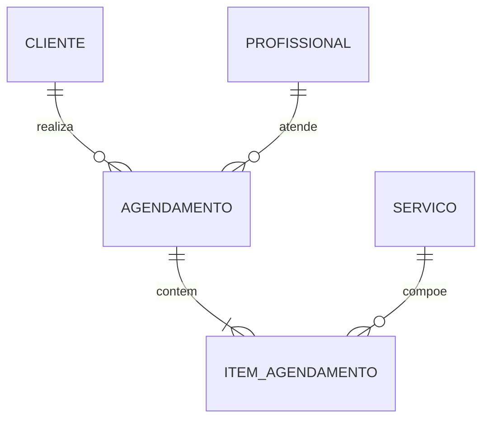

# Projeto Integrador de Banco de Dados — Do Cliente Real ao Dashboard

Atividade em 4 etapas + guia passo a passo para o aluno

## 1. Visão geral

**Objetivo:** em equipe, os alunos levantam os requisitos de um cliente real, modelam um banco de dados relacional, implementam as operações de CRUD e consultas, e entregam views para relatórios e análises, tudo versionado em Git.

**O que o projeto exercita:** levantamento de requisitos, modelagem conceitual/lógica/física, normalização, SQL (DDL, DML, JOINs, subconsultas, CTEs), transações, views, dados analíticos, documentação técnica e trabalho colaborativo com branches e merges.

**Como escolher clientes reais:** pequenos negócios locais (barbearia, clínica, oficina, loja, ONG, academia, escola de idiomas, confeitaria, transportadora). Prefira clientes que ainda controlam tudo em planilha ou caderno: o ganho é visível. Combine com o cliente antes: 10 minutos de entrevista + 1 apresentação final. Se algum grupo não conseguir cliente real, o professor pode fornecer um "cliente simulado" (um colega ou voluntário que responde em personagem).

## 2. Regras de Git do projeto (valem para todas as etapas)

O Git é parte da avaliação, não só uma ferramenta.

**Estrutura de branches**

- `main`: só recebe código revisado e estável. Ninguém faz commit direto nela.
- `develop`: integração do trabalho da equipe.
- `etapa-1-requisitos`, `etapa-2-modelagem`, `etapa-3-crud`, `etapa-4-views`: uma branch por etapa, criada a partir de `develop`.
- `feature/<etapa>-<assunto>-<nome>`: branches curtas de cada aluno. Exemplos: `feature/modelagem-tabela-cliente-ana`, `feature/crud-agendamentos-joao`.

**Fluxo de trabalho**

1. Criar a branch da etapa a partir da `develop`.
2. Cada aluno cria sua `feature/...` a partir da branch da etapa.
3. Commits pequenos e frequentes.
4. Abrir Pull Request (PR) da feature para a branch da etapa; outro aluno revisa e aprova.
5. Ao fechar a etapa, PR da branch da etapa para `develop`.
6. Depois da apresentação da etapa, merge de `develop` em `main` e criação de tag (`v1-requisitos`, `v2-modelagem`, `v3-crud`, `v4-analytics`).

**Padrão de mensagem de commit**

```
tipo(escopo): descrição curta no imperativo

Exemplos:
docs(entrevista): adiciona ata da entrevista com o cliente
feat(ddl): cria tabela agendamento com chaves estrangeiras
fix(crud): corrige update de preço sem WHERE
feat(view): cria vw_faturamento_mensal
```

Tipos: `feat`, `fix`, `docs`, `refactor`, `test`, `chore`.

**Conflitos de merge de propósito:** em duas momentos do projeto (final da Etapa 2 e da Etapa 3) o professor pode exigir que dois alunos alterem o mesmo arquivo (ex.: `schema.sql`) em branches diferentes. Resolver o conflito manualmente e registrar no README (seção "Conflitos resolvidos") o que aconteceu e como foi resolvido.

**Estrutura de pastas do repositório**

```
projeto-<nome-do-cliente>/
├── README.md
├── docs/
│   ├── 01-entrevista/
│   │   ├── roteiro.md
│   │   ├── ata.md
│   │   └── glossario.md
│   ├── 02-modelagem/
│   │   ├── requisitos.md
│   │   ├── regras-de-negocio.md
│   │   ├── modelo-conceitual.md
│   │   ├── modelo-logico.md
│   │   ├── normalizacao.md
│   │   └── dicionario-de-dados.md
│   ├── 03-crud/
│   │   └── catalogo-de-consultas.md
│   └── 04-analytics/
│       └── catalogo-de-views.md
├── sql/
│   ├── 01_schema.sql
│   ├── 02_seed.sql
│   ├── 03_crud/
│   │   ├── cliente.sql
│   │   └── ...
│   ├── 04_views/
│   │   └── relatorios.sql
│   └── 99_testes.sql
└── dashboard/
```

**Checklist de Git para toda entrega**

- [ ] Nenhum commit direto na `main`.
- [ ] Todos os integrantes têm commits.
- [ ] Pelo menos 1 PR revisado por etapa.
- [ ] Tag criada ao final da etapa.
- [ ] README atualizado.

## 3. Etapa 1 — Entrevista com o cliente (10 minutos exatos)

**Meta:** sair da entrevista com informação suficiente para modelar o banco, sem conversa fiada e sem estourar o tempo.

**Entregáveis:** roteiro da entrevista, ata, glossário do negócio, lista de dúvidas em aberto.

### 3.1 Antes da entrevista (preparação, \~1 semana)

**Passo 1 — Pesquisar o negócio.** Cada aluno pesquisa 15 minutos sobre o tipo de negócio do cliente: o que vende, quem são os clientes, como funciona o dia a dia. Registre em `docs/01-entrevista/roteiro.md` uma seção "O que já sabemos". Perguntas que o Google responde **não** entram na entrevista.

**Passo 2 — Montar o roteiro em blocos.** Use o orçamento de tempo abaixo como guia. Cada bloco tem um objetivo e perguntas prioritárias.

| Bloco | Tempo | Objetivo |
| --- | --- | --- |
| Abertura | 0:30 | Apresentação rápida e objetivo da conversa |
| Negócio e processos | 2:30 | Entender o fluxo principal de ponta a ponta |
| Dados e entidades | 3:00 | Descobrir o que precisa ser guardado |
| Regras e exceções | 2:00 | Capturar regras de negócio e casos especiais |
| Relatórios e decisões | 1:30 | Descobrir o que o cliente quer enxergar |
| Encerramento | 0:30 | Confirmar e agradecer |

**Passo 3 — Escrever perguntas assertivas.** Regras:

- Perguntas **abertas** para descobrir ("Como acontece um atendimento, do primeiro contato até o pagamento?").
- Perguntas **fechadas** para confirmar ("Um cliente pode ter mais de um telefone?").
- Evitar perguntas duplas ("Quem são seus clientes e como eles pagam?" vira duas perguntas).
- Evitar jargão técnico com o cliente. Em vez de "qual a cardinalidade?", pergunte "um pedido pode ter vários produtos? E um produto pode estar em vários pedidos?".
- Priorizar: marque as 8 perguntas **obrigatórias** e deixe as demais como reserva.

**Banco de perguntas (adapte ao cliente, escolha só as melhores)**

*Negócio e processos*

- Conte como é um dia comum, desde o primeiro contato do cliente até o pagamento.
- O que você hoje controla em planilha, caderno ou memória?
- Qual é a maior dor ou retrabalho do dia a dia?

*Dados e entidades*

- Quais informações você precisa guardar de cada cliente?
- O que você vende ou oferece? Como é organizado (categorias, tipos)?
- Quem trabalha com você e o que cada pessoa faz no sistema?
- Que documentos você emite ou recebe (nota, recibo, contrato, ficha)?

*Regras e exceções*

- Existe algum preço, desconto ou prazo que muda conforme a situação?
- O que acontece quando algo é cancelado, devolvido ou remarcado?
- Há informação que nunca pode faltar ou se repetir (ex.: CPF, placa, número de série)?

*Relatórios e decisões*

- Que números você gostaria de ver toda semana ou todo mês?
- Que pergunta sobre o seu negócio hoje você não consegue responder?

**Passo 4 — Ensaio.** Façam um ensaio cronometrado entre a própria equipe, com um colega no papel de cliente. A primeira tentativa quase sempre passa de 10 minutos: corte perguntas.

### 3.2 Durante a entrevista

- Comece o cronômetro quando a primeira pergunta for feita.
- Se o cliente se estender em um assunto, quem conduz redireciona com educação ("Entendi, e passando para...").
- Anotem os termos do cliente exatamente como foram ditos: eles viram nomes de tabelas e colunas.
- Em 10:00, encerrem, mesmo que haja perguntas sobrando. Anotem-nas na lista de dúvidas.
- Se o cliente concordar, gravem o áudio apenas para conferir a ata depois.

### 3.3 Depois da entrevista (mesmo dia)

**Passo 1 — Escrever a ata** (`ata.md`) com: data, participantes, resumo por bloco, citações importantes, decisões, pendências.

**Passo 2 — Glossário** (`glossario.md`): cada termo do negócio com definição nas palavras do cliente.

**Passo 3 — Lista de dúvidas:** o que não foi respondido. A equipe pode mandar essas perguntas por mensagem ao cliente (**no máximo 5**) e registrar as respostas na ata.

**Passo 4 — Reflexão da equipe (5 linhas):** o que funcionou e o que faltou na entrevista.

**Git:** tudo em `etapa-1-requisitos` com PR para `develop`; tag `v1-requisitos`.

### 3.4 Critérios de aceite da Etapa 1

- [ ] Entrevista dentro de 10 minutos (registrem o tempo real).
- [ ] Roteiro com perguntas obrigatórias marcadas.
- [ ] Ata completa e glossário com pelo menos 10 termos.
- [ ] Lista de dúvidas e respostas posteriores.
- [ ] PR revisado e tag criada.

## 4. Etapa 2 — Relacionamentos e modelagem do banco (tudo documentado)

**Meta:** transformar a ata em um modelo de dados correto, normalizado e totalmente documentado, com o esquema criado no SGBD.

**Entregáveis:** requisitos e regras de negócio, modelo conceitual (DER), modelo lógico, normalização, dicionário de dados, `01_schema.sql` e `02_seed.sql`.

### 4.1 Passo a passo

**Passo 1 — Extrair requisitos e regras de negócio.** Releia a ata e escreva em `requisitos.md`:

- **Requisitos funcionais:** "O sistema deve permitir..." (ex.: registrar um agendamento).
- **Requisitos de dados:** o que precisa ser armazenado.
- **Regras de negócio** (`regras-de-negocio.md`), numeradas: RN01, RN02... (ex.: "RN03: um cliente não pode ter dois agendamentos no mesmo horário com o mesmo profissional"). Cada regra deve virar uma restrição no banco (UNIQUE, CHECK, FK) ou ficar marcada como "tratada na aplicação".

**Passo 2 — Identificar entidades.** Sublinhe os **substantivos** da ata: viram candidatos a entidade. Descarte os que são apenas atributos. Teste: "preciso guardar vários dados sobre isso, e existem várias ocorrências?" Se sim, é entidade.

**Passo 3 — Identificar atributos.** Para cada entidade, liste atributos, tipo de dado, se é obrigatório e se é identificador. Decida a chave primária (prefira chave substituta `id` quando não houver chave natural estável).

**Passo 4 — Identificar relacionamentos e cardinalidades.** Sublinhe os **verbos**. Para cada par de entidades, responda duas perguntas:

- "Um A se relaciona com quantos B?"
- "Um B se relaciona com quantos A?"

Resultado: 1:1, 1:N ou N:N. Relacionamentos N:N viram **tabela associativa** (e muitas vezes ganham atributos próprios, como quantidade e preço unitário). Defina também a **participação** (obrigatória ou opcional).

**Passo 5 — Desenhar o modelo conceitual.** Use Mermaid (renderiza direto no GitHub/GitLab) ou outra ferramenta (dbdiagram.io, draw.io, brModelo). Exemplo de Mermaid:



**Passo 6 — Converter para o modelo lógico.** Aplique as regras de conversão:

- Entidade → tabela.
- 1:N → chave estrangeira no lado N.
- N:N → tabela associativa com duas FKs (PK composta ou chave substituta + UNIQUE).
- 1:1 → FK com UNIQUE.
- Atributo multivalorado → tabela própria.

**Passo 7 — Normalizar (documentar em `normalizacao.md`).** Para cada tabela, mostre que está na 1FN, 2FN e 3FN. Se você desnormalizou de propósito (ex.: guardar o preço unitário no item do pedido), **justifique** por escrito.

**Passo 8 — Dicionário de dados.** Para cada tabela e coluna:

| Tabela | Coluna | Tipo | Nulo? | Chave | Regra / descrição |
| --- | --- | --- | --- | --- | --- |
| cliente | id | integer (identity) | Não | PK | Identificador do cliente |
| cliente | nome | varchar(120) | Não |  | Nome completo |
| cliente | email | varchar(150) | Sim | UNIQUE | RN02: não repetir e-mail |

**Passo 9 — Escrever o DDL** (`sql/01_schema.sql`). Boas práticas:

- Nomes em minúsculas, `snake_case`, singular e em português ou em inglês (escolha um padrão e mantenha).
- Todas as PKs, FKs, `NOT NULL`, `UNIQUE`, `CHECK` e `DEFAULT` que as regras exigirem.
- Definir `ON DELETE` e `ON UPDATE` de cada FK com justificativa (RESTRICT, CASCADE, SET NULL).
- Índices nas FKs e em colunas muito filtradas.
- Comentários nas tabelas (`COMMENT ON TABLE ...`).

```sql
CREATE TABLE cliente (
    id         integer GENERATED ALWAYS AS IDENTITY PRIMARY KEY,
    nome       varchar(120) NOT NULL,
    email      varchar(150) UNIQUE,
    criado_em  timestamp NOT NULL DEFAULT now()
);
```

**Passo 10 — Popular com dados de teste** (`sql/02_seed.sql`): no mínimo 10 registros nas tabelas principais e dados que cubram os casos especiais citados na entrevista. O script deve rodar do zero em um banco vazio.

**Passo 11 — Validar com o cliente.** Mostre o diagrama em linguagem simples (5 minutos, por mensagem ou presencial) e registre o retorno. Ajuste o modelo se necessário.

### 4.2 Trabalho em equipe e Git nesta etapa

- Divida por **bloco de tabelas**: cada aluno modela e documenta um grupo de entidades em sua própria `feature/`.
- No fim, a equipe integra os modelos. É aqui que acontece o **conflito de merge planejado** em `01_schema.sql`: resolvam, rodem o script inteiro do zero e registrem no README.

### 4.3 Critérios de aceite da Etapa 2

- [ ] Cada regra de negócio rastreável até uma restrição ou nota.
- [ ] DER conceitual e modelo lógico consistentes entre si.
- [ ] Normalização até 3FN comprovada.
- [ ] Dicionário de dados completo.
- [ ] `01_schema.sql` e `02_seed.sql` rodam do zero sem erros.
- [ ] Validação com o cliente registrada.

## 5. Etapa 3 — CRUDs e consultas

**Meta:** escrever e testar todas as operações que o sistema precisa, em SQL puro, documentadas em um catálogo.

**Entregáveis:** `sql/03_crud/*.sql`, `docs/03-crud/catalogo-de-consultas.md`, `sql/99_testes.sql`.

### 5.1 Passo a passo

**Passo 1 — Listar as operações.** A partir dos requisitos funcionais, crie uma tabela com todas as operações:

| Código | Entidade | Operação | Descrição | Origem (RF/RN) |
| --- | --- | --- | --- | --- |
| C-01 | cliente | CREATE | Cadastrar cliente | RF01 |
| R-03 | agendamento | READ | Listar agendamentos do dia por profissional | RF05 |

**Passo 2 — CRUD básico de cada entidade principal.** Em um arquivo por entidade:

- **Create:** `INSERT` (individual e em lote).
- **Read:** `SELECT` por id, listagem com filtro, busca com `LIKE/ILIKE`, ordenação e paginação (`ORDER BY`, `LIMIT`, `OFFSET`).
- **Update:** `UPDATE` sempre com `WHERE`; testar com `SELECT` antes.
- **Delete:** `DELETE` com `WHERE`; discutir quando usar **exclusão lógica** (coluna `ativo` ou `excluido_em`) em vez de apagar de verdade.

**Passo 3 — Consultas com várias tabelas.** No mínimo, para a equipe inteira:

- 5 consultas com `INNER JOIN` e `LEFT JOIN` (ex.: clientes sem nenhum agendamento).
- 3 consultas com agregação (`COUNT`, `SUM`, `AVG`, `GROUP BY`, `HAVING`).
- 2 consultas com subconsulta (escalar, `IN` ou `EXISTS`).
- 1 consulta com CTE (`WITH`).

**Passo 4 — Operações compostas com transação.** Identifique pelo menos 2 processos que mexem em várias tabelas (ex.: registrar um pedido com seus itens e baixar estoque). Escreva-os com `BEGIN`, `COMMIT` e `ROLLBACK`, e demonstre um caso que dá certo e um que falha e reverte.

**Passo 5 — Testar as regras de negócio.** Em `99_testes.sql`, para cada regra RN faça um teste **positivo** (dado válido entra) e um **negativo** (dado inválido é rejeitado pelo banco, com a mensagem de erro anotada em comentário).

**Passo 6 — Medir desempenho (básico).** Escolha 2 consultas com JOIN, rode com `EXPLAIN ANALYZE` antes e depois de criar um índice e registre a diferença.

**Passo 7 — Catálogo de consultas.** Para cada consulta: código, objetivo, SQL, exemplo de resultado e quem a usa (ex.: "recepcionista").

### 5.2 Trabalho em equipe e Git nesta etapa

- Cada aluno cuida de **entidades diferentes** em arquivos diferentes, o que reduz conflitos; as consultas multi-tabela são feitas em duplas.
- Se mexerem no `01_schema.sql` (ex.: faltou um índice ou coluna), façam isso em branch própria `fix/schema-...` com PR, e atualizem o dicionário de dados. Registrar mudanças no modelo é obrigatório.
- Segundo conflito de merge planejado: duas pessoas editam `99_testes.sql`.

### 5.3 Critérios de aceite da Etapa 3

- [ ] CRUD completo das entidades principais.
- [ ] Mínimo de consultas com JOIN, agregação, subconsulta e CTE cumprido.
- [ ] 2 transações demonstradas (sucesso e falha).
- [ ] Testes positivos e negativos para todas as regras de negócio.
- [ ] Catálogo de consultas completo.

## 6. Etapa 4 — Views, relatórios e dashboard

**Meta:** entregar ao cliente respostas às perguntas que ele disse na entrevista que gostaria de enxergar.

**Entregáveis:** `sql/04_views/*.sql`, `docs/04-analytics/catalogo-de-views.md`, dashboard (ferramenta, HTML ou planilha conectada), apresentação final.

### 6.1 Passo a passo

**Passo 1 — Transformar perguntas do cliente em indicadores (KPIs).** Releia o bloco "Relatórios e decisões" da ata. Monte a tabela:

| Pergunta do cliente | Indicador | Fórmula | Frequência | View |
| --- | --- | --- | --- | --- |
| Quanto faturei no mês? | Faturamento mensal | SUM(valor) por mês | Mensal | vw\_faturamento\_mensal |

Precisa haver pelo menos **6 indicadores**.

**Passo 2 — Views de relatório operacional.** Views que escondem JOINs complexos e entregam dados prontos para leitura (ex.: `vw_agenda_do_dia`, `vw_pedidos_detalhados`). Use nomes com prefixo `vw_`.

**Passo 3 — Views analíticas.** Views com agregações: faturamento por período, ranking de produtos/serviços, clientes mais frequentes, taxa de cancelamento, ticket médio. Aplique:

- `GROUP BY` e funções de data (`date_trunc`, `EXTRACT`).
- *Window functions* (`ROW_NUMBER`, `RANK`, `SUM() OVER`) para rankings e acumulados.
- `CASE WHEN` para faixas e categorias.

```sql
CREATE VIEW vw_faturamento_mensal AS
SELECT date_trunc('month', p.data_pagamento) AS mes,
       COUNT(*)                              AS qtd_pagamentos,
       SUM(p.valor)                          AS faturamento
FROM pagamento p
GROUP BY 1
ORDER BY 1;
```

**Passo 4 — Materialized views (opcional, para nota extra).** Para consultas pesadas, crie `MATERIALIZED VIEW` e documente a estratégia de atualização (`REFRESH MATERIALIZED VIEW`).

**Passo 5 — Segurança básica.** Crie pelo menos 2 perfis (`GRANT`), por exemplo um perfil de leitura apenas das views de relatório. Justifique quais dados sensíveis ficam ocultos nas views.

**Passo 6 — Dashboard.** Escolha uma das opções (a equipe decide e justifica):

- Metabase ou Apache Superset (conectam direto no PostgreSQL).
- Grafana.
- Página HTML com gráficos (Chart.js) alimentada por exportação CSV/JSON das views.
- Google Sheets/Looker Studio ou Power BI com as views como fonte.

O dashboard deve ter no mínimo: 4 cartões de números-chave, 3 gráficos de tipos diferentes e 1 tabela de detalhe, **cada um ligado a uma view** do catálogo.

**Passo 7 — Documentar o catálogo de views:** nome, objetivo, indicador atendido, colunas, SQL, quem usa e como atualizar.

**Passo 8 — Apresentação final ao cliente (10 a 15 minutos).** Roteiro: o problema → o modelo (1 diagrama) → demonstração de um fluxo real → dashboard → próximos passos. Registre o feedback do cliente.

### 6.2 Git nesta etapa

- Uma `feature/` por view ou dupla de views.
- Merge final de `etapa-4-views` em `develop`, depois de `develop` em `main`, tag `v4-analytics` e a release `v1.0` com um `.zip` do projeto.

### 6.3 Critérios de aceite da Etapa 4

- [ ] 6 ou mais indicadores ligados a perguntas do cliente.
- [ ] Views operacionais e analíticas documentadas.
- [ ] Pelo menos uma window function.
- [ ] Dashboard funcional com elementos ligados às views.
- [ ] Apresentação ao cliente e feedback registrado.

## 7. Cronograma sugerido (5 semanas)

| Semana | Foco | Marco |
| --- | --- | --- |
| 1 | Pesquisa, roteiro, ensaio e entrevista | Tag `v1-requisitos` |
| 2 | Requisitos, DER e modelo lógico | Modelo validado com o cliente |
| 3 | DDL, seed, CRUD básico | Tag `v2-modelagem` |
| 4 | Consultas, transações, testes | Tag `v3-crud` |
| 5 | Views, dashboard, apresentação final | Tag `v4-analytics` e release `v1.0` |

Se a turma tiver menos tempo, funda as semanas 3 e 4 reduzindo o número mínimo de consultas.

## 8. Avaliação (rubrica sugerida, 100 pontos)

| Critério | Peso |
| --- | --- |
| Etapa 1: entrevista, ata e glossário | 15 |
| Etapa 2: modelo, normalização e documentação | 25 |
| Etapa 3: CRUD, consultas, transações e testes | 20 |
| Etapa 4: views e dashboard | 20 |
| Git: branches, PRs, commits e resolução de conflitos | 10 |
| Apresentação final e feedback do cliente | 10 |

**Avaliação individual (ajuste de nota):** o histórico de commits e PRs mostra quem contribuiu; some uma pergunta oral individual na apresentação ("explique por que esta FK tem ON DELETE RESTRICT").

**Níveis de desempenho por critério**

- **Excelente:** completo, consistente, justificado e sem erros.
- **Bom:** completo, com pequenas falhas de padrão ou justificativa.
- **Parcial:** faltam itens ou há inconsistências entre documentação e banco.
- **Insuficiente:** não roda, não está documentado ou não segue o fluxo Git.

## 9. Anexos (modelos prontos para copiar)

### 9.1 Modelo de ata da entrevista

```
# Ata da entrevista
Data: __/__/____   Duração real: __:__
Cliente: ______   Negócio: ______
Equipe: entrevistador, anotador, cronometrista, observador

## Resumo por bloco
- Negócio e processos:
- Dados e entidades:
- Regras e exceções:
- Relatórios e decisões:

## Citações importantes (palavras do cliente)
-

## Pendências e dúvidas
-
```

### 9.2 Modelo de Pull Request

```
## O que foi feito
## Arquivos alterados
## Como testar (comandos)
## Checklist
- [ ] Script roda do zero
- [ ] Documentação atualizada
- [ ] Segui o padrão de nomes
```

### 9.3 Comandos Git de apoio

```
git checkout -b develop
git checkout -b etapa-2-modelagem develop
git checkout -b feature/modelagem-tabela-cliente-ana etapa-2-modelagem
git add . && git commit -m "feat(ddl): cria tabela cliente"
git push -u origin feature/modelagem-tabela-cliente-ana
# depois do PR aprovado:
git checkout etapa-2-modelagem && git pull
git merge --no-ff feature/modelagem-tabela-cliente-ana
# resolver conflito: editar o arquivo, remover <<<<<<< ======= >>>>>>>
git add arquivo.sql && git commit
git tag -a v2-modelagem -m "Entrega da etapa 2"
git push origin --tags
```

### 9.4 Erros comuns (aviso à turma)

- Entrevista que vira conversa solta e estoura o tempo.
- Entidades que são na verdade atributos (ex.: "Cidade" como tabela sem necessidade).
- Esquecer a tabela associativa em relacionamentos N:N.
- `UPDATE` ou `DELETE` sem `WHERE`.
- Views que ninguém sabe a que pergunta do cliente respondem.
- Commits gigantes de última hora e `main` quebrada.
- Documentação desatualizada em relação ao banco real.

### 9.5 Checklist final de entrega

- [ ] Repositório com estrutura de pastas e README completo.
- [ ] Todas as tags (`v1` a `v4`) e release `v1.0`.
- [ ] Scripts rodam em ordem: schema, seed, CRUD, views, testes.
- [ ] Dicionário de dados, DER e catálogos atualizados.
- [ ] Dashboard funcionando e prints no README.
- [ ] Feedback do cliente anexado.
